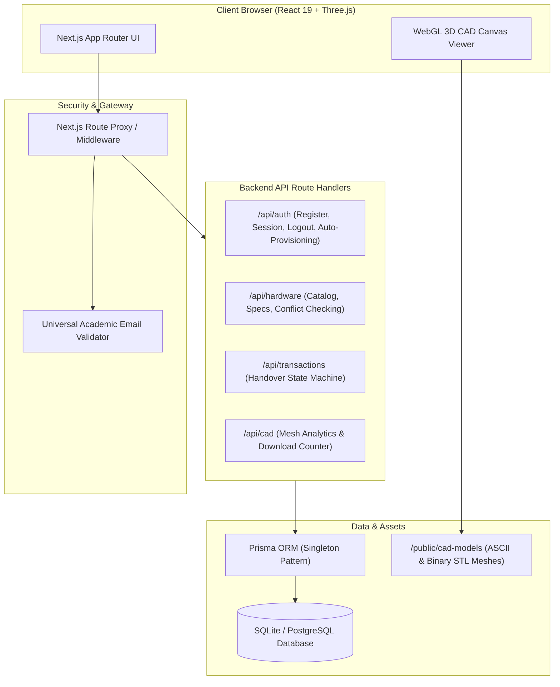

# 🚀 Campus-Share
### Non-Profit Campus Hardware & CAD Resource Platform for University Engineers

[](https://nextjs.org/)
[](https://react.dev/)
[](https://www.typescriptlang.org/)
[](https://tailwindcss.com/)
[](https://www.prisma.io/)
[](https://threejs.org/)
[](LICENSE)

**Campus-Share** is a full-stack, non-profit academic platform built for university engineering students, research labs, and makerspaces. It enables peer-to-peer and lab-to-peer hardware lending (microcontrollers, sensors, motors, test instruments) coupled with an open-source 3D CAD repository featuring in-browser WebGL STL mesh inspection.

---

## 📑 Table of Contents

- [Architectural Overview](#-architectural-overview)
- [Complete Tech Stack](#-complete-tech-stack)
- [Core Features](#-core-features)
- [Interactive 3D CAD Hub](#-interactive-3d-cad-hub)
- [Campus Trust System](#-campus-trust-system)
- [Project Directory Structure](#-project-directory-structure)
- [Setup & Installation](#-setup--installation)
- [API Reference](#-api-reference)
- [Default Demo Accounts](#-default-demo-accounts)
- [Deployment Guide](#-deployment-guide)

---

## 🏛️ Architectural Overview



---

## 🛠️ Complete Tech Stack

### Frontend Architecture
| Technology | Version | Purpose |
| :--- | :--- | :--- |
| **Next.js (App Router)** | `16.4.2` | React Server Components, client boundaries, streaming rendering, dynamic metadata. |
| **React** | `19.3.0` | Modern React primitives with concurrent rendering and optimized hook lifecycles. |
| **TypeScript** | `5.x` | Strict type safety across database models, API payloads, and component props. |
| **Tailwind CSS** | `v4` | High-performance engineering dark/light theme (Slate-950, Blueprint-Blue, Bio-Emerald). |
| **Lucide Icons** | `1.60.0` | Comprehensive technical and interface iconography. |
| **Three.js** | `0.186.1` | Lightweight WebGL STL mesh ingestion, polygon counting, orbit camera controls. |

### Backend & Data Architecture
| Technology | Version | Purpose |
| :--- | :--- | :--- |
| **Next.js Route Handlers** | `16.4.2` | RESTful endpoints with parameter validation, error boundaries, and status codes. |
| **Prisma ORM** | `6.4.1` | Type-safe schema migrations, relations, and query optimization via singleton connection. |
| **Database** | SQLite / Postgres | Zero-config turnkey local prototyping (`dev.db`), production-ready for PostgreSQL. |
| **NextAuth.js** | `4.24.15` | Session JWT management, Google OAuth workspace provider, role-based access control. |
| **Bcrypt.js** | `3.0.3` | Password hashing with 10 salt rounds for credential safety. |

---

## 🔑 Core Features

### 1. 🎓 Universal Academic Email & Frictionless Authentication
- **Multi-Domain Recognition:** Supports all accredited academic domains (`.edu.in`, `.ac.in`, `.edu`, `.ac.uk`, `.edu.au`, `.ac.jp`), as well as standard personal emails.
- **Institution Auto-Detection:** Automatically extracts college identity (e.g. `student@drait.edu.in` $\rightarrow$ `DRAIT`, `name@uvce.edu.in` $\rightarrow$ `UVCE`) and tags it on the profile.
- **Instant Auto-Provisioning on Sign-In:** When signing in with any new email on `/auth/signin`, the platform automatically provisions a verified student account on the fly with a base **100 Trust Score**.
- **Instant Logout & Account Switcher:** One-click **"Switch ID"** button in the navbar and dashboard to terminate sessions cleanly without browser caching issues.

### 2. ⚡ Hardware Lending Engine & Double-Booking Prevention
- **Categorized Campus Inventory:**
  - **Embedded Boards:** STM32 Nucleo, ESP32-WROOM, Arduino Uno R4, Raspberry Pi.
  - **Sensors:** BNO055 9-DOF IMU, 24GHz mmWave Radar, Time-of-Flight LiDAR, RFID.
  - **Actuators & Motors:** NEMA 17 Steppers, Brushless Gimbal Motors, ODrive v3.6.
  - **Lab Instruments:** Rigol Digital Oscilloscope, Hakko Soldering Station, Logic Analyzers.
- **Conflict Prevention Algorithm:**
  $$\text{Overlap} \iff (Start_{requested} < End_{existing}) \land (End_{requested} > Start_{existing})$$
- **Handover Lifecycle State Machine:**
  $$\text{PENDING} \longrightarrow \text{APPROVED} \longrightarrow \text{CHECKED\_OUT} \longrightarrow \text{RETURNED}$$

### 3. 📐 Interactive 3D CAD Hub with Three.js
- In-browser interactive inspection of mechanical engineering files (`.STL`, `.STEP`, `.OBJ`).
- Real-time Orbit Controls (rotate, zoom, pan).
- Live Wireframe toggle overlay.
- Automatic bounding box millimeter dimensions ($X \times Y \times Z\text{ mm}$).
- Triangles / polygon face counter.
- Material shader presets: *Blueprint Blue, Carbon Fiber Slate, PLA Orange, Bio-Emerald, Titanium White*.

### 4. 🛡️ Campus Trust Score Protocol
- Non-profit sustainability model replacing monetary fees with an institutional reputation ledger:
  - `+15 Points`: On-time verified return of borrowed equipment.
  - `+10 Points`: Contributing hardware into the campus pool.
  - `+15 Points`: Publishing tested CAD models.
  - `-15 Points`: Late return deduction.
  - `Tier 1 Honor (120+ pts)`: Zero security deposits required on high-value test equipment.

---

## 📁 Project Directory Structure

```text
uvcehackathon/
├── docs/
│   ├── ARCHITECTURE.md          # Comprehensive architectural specs & state diagrams
│   └── API_DOCUMENTATION.md     # Full REST API endpoints, schemas & payloads
├── prisma/
│   ├── schema.prisma            # Relational database schema (Users, Hardware, Bookings, CAD)
│   └── seed.js                  # Realistic engineering seed dataset
├── public/
│   ├── cad-models/              # 3D STL mesh files (cycloidal drive, stator, enclosure, gimbal)
│   └── uploads/                 # Storage directory for user uploads
├── scripts/
│   └── generate-stl-samples.js  # Procedural STL geometry generator
├── src/
│   ├── app/
│   │   ├── layout.tsx           # Global root layout with dynamic Navbar & Footer
│   │   ├── page.tsx             # Landing page with telemetry metrics & catalog preview
│   │   ├── hardware/
│   │   │   ├── page.tsx         # Searchable & filterable hardware catalog
│   │   │   └── [id]/page.tsx    # Hardware detail, specs table & reservation card
│   │   ├── cad-hub/
│   │   │   ├── page.tsx         # CAD repository with WebGL modal viewer
│   │   │   └── [id]/page.tsx    # Dedicated 3D viewer & manufacturing parameters
│   │   ├── dashboard/page.tsx   # Student borrowings, lending requests & trust ledger
│   │   ├── admin/page.tsx       # Lab coordinator panel & campus inventory controls
│   │   ├── upload/page.tsx      # Dual-tab resource listing form (Hardware / CAD)
│   │   ├── auth/
│   │   │   ├── signin/page.tsx  # Universal academic sign-in with live domain validation
│   │   │   └── signup/page.tsx  # Student profile registration with roll number
│   │   └── api/
│   │       ├── auth/
│   │       │   ├── [...nextauth]/route.ts  # NextAuth JWT & OAuth handler
│   │       │   ├── register/route.ts       # Registration API
│   │       │   ├── logout/route.ts         # Complete session clearing
│   │       │   ├── me/route.ts             # Profile & test account switcher
│   │       │   └── switch/route.ts         # Fast role switcher
│   │       ├── hardware/                   # Hardware CRUD routes
│   │       ├── transactions/               # Conflict-free booking engine
│   │       ├── cad/                        # CAD models catalog & download tracker
│   │       └── admin/stats/route.ts        # Telemetry & equipment metrics
│   ├── components/
│   │   ├── CadCanvasViewer.tsx      # Three.js WebGL CAD viewer component
│   │   ├── HardwareBookingCard.tsx  # Conflict validation & booking widget
│   │   ├── StudentDashboard.tsx     # Student due dates & handover tracker
│   │   ├── Navbar.tsx               # Header with mobile menu & logout
│   │   ├── NavbarAuthButton.tsx     # Profile pill, live trust points & switch button
│   │   └── Footer.tsx               # Non-profit sustainability footer
│   ├── lib/
│   │   ├── prisma.ts                # Prisma singleton instance
│   │   ├── auth.ts                  # NextAuth options & RBAC helpers
│   │   └── validators/
│   │       └── academicEmail.ts     # Universal academic regex & domain extractor
│   └── middleware.ts                # Route protection proxy
├── .env.example                     # Environment configuration template
├── package.json                     # Dependencies & execution scripts
└── tsconfig.json                    # TypeScript compiler configuration
```

---

## ⚡ Setup & Installation

### 1. Clone & Install Dependencies
```bash
git clone <your-repository-url>
cd uvcehackathon
npm install
```

### 2. Configure Environment Variables
Copy `.env.example` to `.env`:
```bash
cp .env.example .env
```
Default local configuration:
```env
DATABASE_URL="file:./dev.db"
NEXTAUTH_SECRET="campus_share_super_secret_jwt_key_2026_uvce"
NEXTAUTH_URL="http://localhost:3000"
NEXT_PUBLIC_APP_URL="http://localhost:3000"
ALLOW_ALL_EMAILS="true"
```

### 3. Initialize Database & Generate 3D Assets
```bash
# Push schema to SQLite
npm run db:push

# Generate sample 3D STL files
node scripts/generate-stl-samples.js

# Seed database with authentic engineering items & student profiles
node prisma/seed.js
```

### 4. Launch Development Server
```bash
npm run dev
```
Open **[http://localhost:3000](http://localhost:3000)** in your browser.

---

## 👥 Default Demo Accounts

You can sign in using any of the seeded accounts below, or type your own email into the login page to have an account automatically created:

| Role | Name | Email | Password | Trust Score |
| :--- | :--- | :--- | :--- | :--- |
| **Student (ECE)** | Aarav Sharma | `aarav.sharma@campus.edu` | `campus123` | ⚡ 140 pts |
| **Student (Mech)** | Priya Nair | `priya.nair@campus.ac.in` | `campus123` | ⚡ 115 pts |
| **Lab Coordinator** | Dr. M. S. Venkatesh | `labadmin.ece@campus.ac.in` | `campus123` | ⚡ 500 pts |

---

## 📚 Detailed Documentation Links

- **[System Architecture & Flowcharts](docs/ARCHITECTURE.md)** — Architectural diagrams, state machine specifications, Three.js WebGL rendering pipeline, and Prisma ER model.
- **[REST API Documentation](docs/API_DOCUMENTATION.md)** — Comprehensive parameter schemas, JSON payloads, and HTTP response codes.

---

## 📄 License
This project is open-source under the **MIT License**. Built with ❤️ for university engineering communities.
